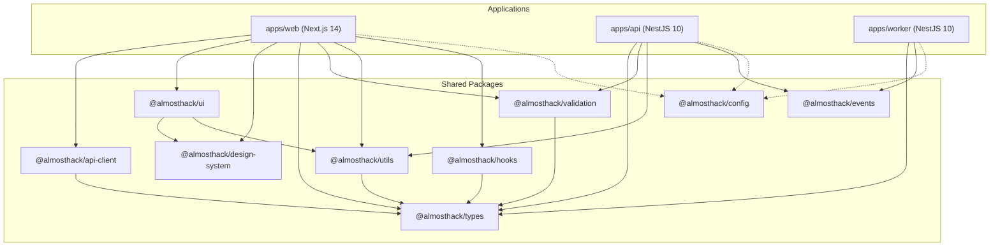
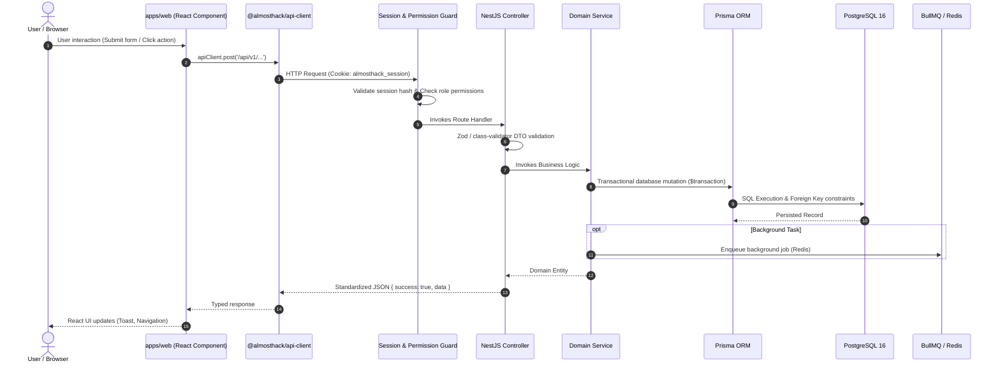

# ALMOSTHACK — AUDIT ARCHITECTURE & REPOSITORY MAP

**Audit Date:** October 13, 2026  
**Auditor:** Principal Software Architect & Staff Full-Stack Engineer  
**Scope:** Monorepo architecture, package dependency graph, module boundaries, data flows, and code organization.

---

## 1. Verified Repository Map

AlmostHack is organized as a pnpm workspace monorepo managed with Turborepo (`turbo.json` v2.10.9).

```
almosthack/
├── apps/
│   ├── api/                 # NestJS 10.4 REST API & WebSocket service (Port 4000)
│   │   ├── prisma/          # Prisma schema (1017 lines) & 13 SQL migrations
│   │   ├── src/
│   │   │   ├── common/      # Interceptors, Filters, Guards, Logger, Middleware
│   │   │   ├── config/      # Env validation (Joi/class-validator)
│   │   │   ├── database/    # PrismaService singleton
│   │   │   ├── infrastructure/ # RedisService, QueueService (BullMQ)
│   │   │   └── modules/     # 18 domain modules (15 active, 3 empty scaffolds)
│   │   └── test/            # 20 Jest E2E test suites (180+ test specs)
│   ├── web/                 # Next.js 14.2 App Router frontend application (Port 3000)
│   │   └── src/
│   │       ├── app/         # 45 App Router pages and route groups
│   │       ├── components/  # 20 feature-based component libraries
│   │       ├── hooks/       # Shell state & responsive hooks
│   │       ├── lib/         # API Client instance (`apiClient`)
│   │       └── providers/   # AuthProvider, QueryProvider
│   └── worker/              # NestJS background worker service for BullMQ queues
│       └── src/
│           └── queues/      # BullMQ processors (only infrastructure-test present)
├── packages/
│   ├── api-client/          # Isomorphic fetch-based API client (`ApiClient`)
│   ├── config/              # Shared ESLint, Prettier, TypeScript configurations
│   ├── design-system/       # Design tokens (colors, typography, spacing, animations)
│   ├── events/              # Domain event interfaces & event types
│   ├── hooks/               # Shared React hooks (debounce, keyboard, media-query)
│   ├── types/               # Shared TypeScript domain interfaces & Enums
│   ├── ui/                  # Shared Tailwind React component library (48 components)
│   ├── utils/               # Formatting, permissions logic, math, date utilities
│   └── validation/          # Zod validation schemas for all domain entities & DTOs
├── scripts/                 # Node.js operational & audit scripts
│   ├── health-check.js      # Production HTTP health probe validator
│   ├── performance-benchmark.ts # Latency and throughput benchmarking
│   ├── security-audit.js    # Pre-release script checking secrets & hygiene
│   └── smoke-test.js        # Post-deployment end-to-end smoke test script
├── docs/                    # Architecture, ADRs (s0 to s12), runbooks, deployment
├── .github/workflows/       # GitHub Actions CI, staging, and production release pipelines
├── docker-compose.yml       # Local multi-service composition (postgres, redis, api, web, worker)
└── pnpm-workspace.yaml      # Monorepo workspace definition
```

---

## 2. Package Dependency Graph



### Dependency Hygiene Audit
- **Circular Dependencies:** 0 circular package dependencies detected. Dependency arrows flow cleanly from applications to shared packages, with `@almosthack/types` acting as the foundational leaf.
- **Missing Declared Packages:** All 12 packages listed in `pnpm-workspace.yaml` exist and compile successfully under TypeScript.
- **Lockfile Consistency:** `pnpm-lock.yaml` is fully synchronized with `package.json` across all workspaces (`--frozen-lockfile` executes without errors).

---

## 3. End-to-End Data Flow Architecture

The intended platform data flow traverses from the browser to the PostgreSQL database through a 9-step pipeline:



---

## 4. Architectural Deficiencies & Dead Code

### 4.1 Empty Scaffold Modules (Dead Code)
Inspection of `apps/api/src/modules` identified three empty module files that provide zero functionality:
1. `apps/api/src/modules/appeals/appeals.module.ts`:
   ```typescript
   import { Module } from '@nestjs/common';
   @Module({})
   export class AppealsModule {}
   ```
2. `apps/api/src/modules/rounds/rounds.module.ts`:
   ```typescript
   import { Module } from '@nestjs/common';
   @Module({})
   export class RoundsModule {}
   ```
3. `apps/api/src/modules/teams/teams.module.ts`:
   ```typescript
   import { Module } from '@nestjs/common';
   @Module({})
   export class TeamsModule {}
   ```
*Finding:* The teams domain was implemented directly inside `HackathonsController` and `HackathonsService`, leaving `teams.module.ts` as an abandoned artifact. `AppealsModule` and `RoundsModule` are placeholder stubs representing unimplemented features.

### 4.2 Oversized God-Modules
- `HackathonsController` (`apps/api/src/modules/hackathons/hackathons.controller.ts`) is **981 lines** long, managing Hackathons, Rules, Configurations, Tracks, Challenges, Registrations, Teams, and Invitations.
- `HackathonsService` (`apps/api/src/modules/hackathons/hackathons.service.ts`) is **1,280 lines** (37 KB), violating single-responsibility principles and bundling disparate domain lifecycles into a monolithic service.

### 4.3 Background Worker Scaffolding (`apps/worker`)
The `apps/worker` application is registered in `docker-compose.yml` and `.github/workflows/deploy-production.yml` as an essential service. However:
- The queue directory (`apps/worker/src/queues/`) contains **only one processor**: `infrastructure-test.processor.ts`.
- There are **no queue processors** for:
  - Repository cloning and snapshot extraction
  - Plagiarism / code similarity analysis
  - Certificate PDF generation
  - Email / notification dispatch
- As a consequence, all long-running computational tasks either execute **synchronously on the main HTTP thread** (like integrity analysis) or are not implemented at all.

### 4.4 Missing Cron Scheduler
`NotificationSchedulerService` (`apps/api/src/modules/notifications/scheduler/notification-scheduler.service.ts`) defines `processDueScheduledAnnouncements()` and `processMilestoneReminders()`.
- However, NestJS `ScheduleModule` is **never imported** into `AppModule` or `NotificationsModule`.
- Neither method has a `@Cron()` or `@Interval()` decorator.
- Grep analysis confirms these methods are only ever called in an automated E2E test file (`announcements.e2e-spec.ts`). In a live deployment, scheduled announcements and deadline reminders will never fire.

---

## 5. Domain Feature-to-File Mapping

| Product Domain | Frontend Page / Hook | Backend Controller / Service | Database Models | Implementation Status |
|---|---|---|---|---|
| **Identity & Sessions** | `/login`, `/register`, `auth-provider.tsx` | `AuthController`, `AuthService`, `SessionService` | `User`, `Session`, `Role`, `UserRole` | **Verified Complete** |
| **Organizations** | `/organizations`, `/organizations/[id]` | `OrganizationsController`, `OrganizationsService` | `Organization`, `OrganizationMember` | **Verified Complete** |
| **Hackathon Core** | `/hackathons`, `/hackathons/[id]`, `/hackathons/new` | `HackathonsController`, `HackathonsService` | `Hackathon`, `HackathonTrack`, `HackathonChallenge` | **Verified Complete** |
| **Registrations** | `/hackathons/[id]/registrations`, `use-registrations.ts` | `HackathonsController` (Registration endpoints) | `ParticipantRegistration` | **Partial** (Frontend uses mock data fallback) |
| **Teams** | `/hackathons/[id]/teams`, `use-teams.ts` | `HackathonsController` (Team endpoints) | `Team`, `TeamMember`, `TeamInvitation` | **Partial** (Frontend uses mock data fallback) |
| **GitHub Integration** | `/repositories`, `use-shell-state.ts` | `RepositoriesController`, `GitHubProviderService` | `GitHubAccount`, `Repository`, `OAuthState` | **Partial** (No webhooks, fallback encryption key) |
| **Submissions** | `/hackathons/[id]/submissions`, `use-submissions.ts` | `SubmissionsController`, `SubmissionsService` | `Submission` | **Partial** (Fake frontend finalization on error) |
| **Judging & Rubrics** | `/hackathons/[id]/judging`, `use-judging.ts` | `JudgingController`, `JudgingService` | `JudgingCriterion`, `JudgeAssignment`, `JudgeEvaluation`, `EvaluationScore` | **Verified Complete (Backend)** / **Mock (UI)** |
| **Transparent Judging** | `/hackathons/[id]/results/[id]`, `use-transparent-judging.ts` | `JudgingService`, `ResultsService` | `JudgeEvaluation`, `EvaluationScore` | **Partial** (Frontend relies on mock evaluations) |
| **Integrity & Plagiarism** | `/hackathons/[id]/integrity` | `IntegrityController`, `IntegrityService` | `IntegrityAnalysis`, `IntegrityFinding`, `IntegrityEvidence`, `IntegrityReview` | **Broken** (Backend generates synthetic mock code; sync HTTP loop) |
| **Results & Leaderboard** | `/hackathons/[id]/results`, `use-results.ts` | `ResultsController`, `ResultsService` | `ResultSet`, `ResultEntry` | **Verified Complete (Backend)** / **Mock (UI)** |
| **Certificates** | `/certificates`, `use-certificates.ts` | **None** (Missing) | **None** (Missing) | **Mocked / UI Only** (Zero backend implementation) |
| **Custom Awards** | Assign Winner Modal in `use-results.ts` | **None** (Missing) | **None** (Missing) | **Mocked / UI Only** (Client-side state only) |
| **Announcements** | `/hackathons/[id]/announcements`, `use-announcements.ts` | `AnnouncementsController`, `AnnouncementsService` | `Announcement` | **Verified Complete** (In-app only; no scheduler cron) |
| **Notifications** | `/notifications` | `NotificationsController`, `NotificationsService` | `Notification`, `NotificationPreference` | **Verified Complete** (In-app only; no email/SMS) |
| **Operational Analytics** | `/analytics`, `use-analytics.ts` | **None** (Only operational `/metrics`) | **None** (No analytics aggregations) | **Mocked / UI Only** |
| **Audit Logs** | `/audit-logs`, `/hackathons/[id]/audit-log` | `AuditController`, `AuditService` | `AuditLog` | **Partial** (No tenant scoping on query endpoint) |
