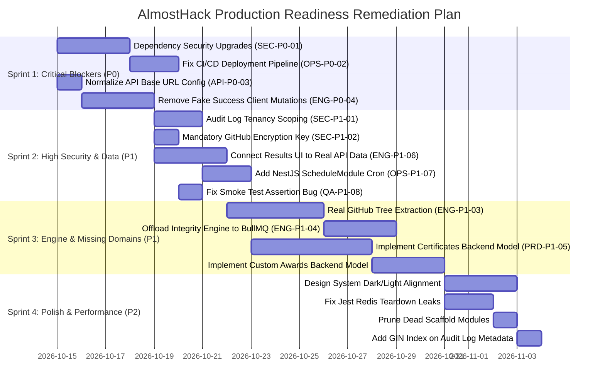

# ALMOSTHACK — REMEDIATION ROADMAP

**Audit Date:** October 13, 2026  
**Auditor:** Principal Software Architect, Staff Full-Stack Engineer, Security Auditor & QA Lead  
**Remediation Principle:** Fix critical security vulnerabilities, broken core workflows, and data integrity risks before implementing UI enhancements or visual polish.

---

## 1. Remediation Sprints Overview



---

## 2. Sprint 1: Critical Security & Release Blockers (P0)

### Task 1.1 — Remediate 93 Dependency Vulnerabilities
- **Task ID:** `REM-P0-01` (Finding `SEC-P0-01`)
- **Severity:** P0 — Critical | **Confidence:** High
- **Evidence:** `pnpm audit` reports 93 vulnerabilities (6 critical, 45 high). Next.js `14.2.35`, `body-parser`, and `multer` require upgrades.
- **Impact:** Remote exploitation, SSR request forgery, and DoS risk.
- **Recommended Fix:**
  1. Upgrade `next` in `apps/web/package.json` to `>=14.2.36` or evaluate Next.js 15 upgrade.
  2. Add `pnpm.overrides` in root `package.json` for `body-parser: >=1.20.6` and `multer: >=2.3.0`.
  3. Re-run `pnpm install` and verify build compatibility.
- **Required Regression Tests:**
  - `pnpm audit` returns 0 vulnerabilities.
  - `pnpm exec turbo run build` passes for all workspaces.
- **Dependencies:** None.
- **Estimated Effort:** 2–3 engineer days (Estimate).

---

### Task 1.2 — Fix Production Deployment Pipeline in GitHub Actions
- **Task ID:** `REM-P0-02` (Finding `OPS-P0-02`)
- **Severity:** P0 — Critical | **Confidence:** High
- **Evidence:** `.github/workflows/deploy-production.yml` builds Docker images on the runner but never tags/pushes them to a registry, and executes no deployment command.
- **Impact:** Release workflow produces no deployed artifact; production code cannot be updated.
- **Recommended Fix:**
  1. Add login step for Amazon ECR or GitHub Container Registry (GHCR).
  2. Tag and push `almosthack-api`, `almosthack-web`, and `almosthack-worker` images with immutable commit SHA and `latest` tags.
  3. Add automated deployment step (e.g. AWS ECS task definition update or Kubernetes deployment rollout).
- **Required Regression Tests:**
  - Dry-run release pipeline in staging and assert images exist in registry.
- **Dependencies:** Container registry credentials configured in repository secrets.
- **Estimated Effort:** 1–2 engineer days (Estimate).

---

### Task 1.3 — Normalize API Base URL Configuration & Version Prefix
- **Task ID:** `REM-P0-03` (Finding `API-P0-03`)
- **Severity:** P0 — Critical | **Confidence:** High
- **Evidence:** `apps/web/src/lib/api-client.ts` falls back to `'http://localhost:4000/api/v1'`, but `.env.example` and `docker-compose.yml` set `NEXT_PUBLIC_API_URL="http://localhost:4000"`. When set, all requests omit `/api/v1` and fail with 404.
- **Impact:** Complete failure of all frontend API queries and mutations when using standard environment templates.
- **Recommended Fix:**
  Update `apps/web/src/lib/api-client.ts` to ensure the `/api/v1` prefix is always normalized:
  ```typescript
  const rawBase = process.env.NEXT_PUBLIC_API_URL || 'http://localhost:4000';
  const cleanBase = rawBase.replace(/\/+$/, '');
  const API_BASE_URL = cleanBase.endsWith('/api/v1') ? cleanBase : `${cleanBase}/api/v1`;
  ```
- **Required Regression Tests:**
  - Unit tests verifying `apiClient` requests hit `/api/v1/...` regardless of whether `NEXT_PUBLIC_API_URL` has a trailing slash, has `/api/v1`, or has neither.
- **Dependencies:** None.
- **Estimated Effort:** 0.5 engineer days (Estimate).

---

### Task 1.4 — Remove Fake Success Client Mutations & Expose Real Server Errors
- **Task ID:** `REM-P0-04` (Finding `ENG-P0-04` / `SEC-P2-03`)
- **Severity:** P0 — Critical | **Confidence:** High
- **Evidence:** In `use-submissions.ts`, `use-results.ts`, and `use-certificates.ts`, mutation errors are swallowed in empty `catch` blocks and local state is mutated to simulated success (`FINALIZED`, `PASSED`, `APPROVED`).
- **Impact:** Users are shown false success states when backend authorization or validation rejects requests.
- **Recommended Fix:**
  1. Remove all empty `catch` blocks in mutation functions.
  2. Allow `apiClient` errors to bubble up to React Query `onError` handlers.
  3. Display descriptive toast notifications or inline error banners containing `error.message`.
- **Required Regression Tests:**
  - Component tests verifying that 403/409 errors keep submission state untouched and display error alerts.
- **Dependencies:** `REM-P0-03`.
- **Estimated Effort:** 2–3 engineer days (Estimate).

---

## 3. Sprint 2: High Security & Real Data Binding (P1)

### Task 2.1 — Enforce Tenant Scoping on Audit Log Query Endpoint
- **Task ID:** `REM-P1-01` (Finding `SEC-P1-02`)
- **Severity:** P1 — High | **Confidence:** High
- **Evidence:** `AuditController.getAuditLogs` queries logs globally without passing `organizationId`.
- **Impact:** Cross-tenant information disclosure; organizers can view audit logs belonging to other organizations.
- **Recommended Fix:**
  Extract `organizationId` from authenticated user's active membership context and pass it into `auditService.queryAuditLogs(query, organizationId)`.
- **Required Regression Tests:**
  - E2E test verifying that user from Org A querying audit logs only receives entries where `metadata.organizationId == Org A`.
- **Dependencies:** None.
- **Estimated Effort:** 1–2 engineer days (Estimate).

---

### Task 2.2 — Require Mandatory Non-Empty Encryption Key on Startup
- **Task ID:** `REM-P1-02` (Finding `SEC-P1-01`)
- **Severity:** P1 — High | **Confidence:** High
- **Evidence:** `GitHubCredentialService` falls back to static string `'almosthack-dev-default-encryption-secret-key-32bytes'`.
- **Impact:** Insecure token storage if environment variable is missing.
- **Recommended Fix:**
  1. Add strict Joi validation in `apps/api/src/config/env.validation.ts` requiring `ENCRYPTION_KEY` to be defined in production.
  2. In `GitHubCredentialService`, throw an error on startup if `process.env.ENCRYPTION_KEY` is undefined.
- **Required Regression Tests:**
  - Config unit tests verifying that missing `ENCRYPTION_KEY` halts process initialization.
- **Dependencies:** None.
- **Estimated Effort:** 0.5 engineer days (Estimate).

---

### Task 2.3 — Connect Results & Leaderboard UI to Real Backend Calculations
- **Task ID:** `REM-P1-03` (Finding `ENG-P1-06`)
- **Severity:** P1 — High | **Confidence:** High
- **Evidence:** `use-results.ts` queries the backend results endpoint but discards the payload and filters `MOCK_RANKINGS`.
- **Impact:** Organizers and participants see hardcoded mock rankings instead of authoritative calculations.
- **Recommended Fix:**
  1. Bind `resultsData` directly to `rankings` state in `use-results.ts`.
  2. Render empty podium and prompt organizer to "Calculate Results" when no `ResultSet` exists.
- **Required Regression Tests:**
  - Verify that calculating results on backend immediately refreshes leaderboard UI with real data.
- **Dependencies:** `REM-P0-03`, `REM-P0-04`.
- **Estimated Effort:** 2–3 engineer days (Estimate).

---

### Task 2.4 — Add NestJS ScheduleModule for Cron Triggers
- **Task ID:** `REM-P1-04` (Finding `OPS-P1-07`)
- **Severity:** P1 — High | **Confidence:** High
- **Evidence:** `NotificationSchedulerService` methods are never invoked because no cron scheduler is registered.
- **Impact:** Scheduled announcements and 24h milestone deadline notifications never fire.
- **Recommended Fix:**
  1. Install and register `@nestjs/schedule` in `AppModule`.
  2. Annotate `processDueScheduledAnnouncements()` with `@Cron(CronExpression.EVERY_MINUTE)`.
  3. Annotate `processMilestoneReminders()` with `@Cron(CronExpression.EVERY_HOUR)`.
- **Required Regression Tests:**
  - Automated test verifying scheduled announcements transition to `PUBLISHED` when the cron fires.
- **Dependencies:** None.
- **Estimated Effort:** 1–2 engineer days (Estimate).

---

### Task 2.5 — Fix Assertion Bug in Deployment Smoke Test Script
- **Task ID:** `REM-P1-05` (Finding `QA-P1-08`)
- **Severity:** P1 — High | **Confidence:** High
- **Evidence:** `scripts/smoke-test.js` checks `if (!res.data.data?.user?.id)`, but API returns `{ success: true, data: user }`, making `res.data.data.id` the correct path.
- **Impact:** Deployment smoke tests fail every time on step 5.
- **Recommended Fix:**
  Update line 146 in `scripts/smoke-test.js` to:
  ```javascript
  const returnedUser = res.data.data?.user || res.data.data;
  if (!returnedUser?.id) throw new Error('Missing user ID in response');
  userId = returnedUser.id;
  ```
- **Required Regression Tests:**
  - Run `scripts/smoke-test.js` against local or staging API and verify Step 5 passes.
- **Dependencies:** None.
- **Estimated Effort:** 0.5 engineer days (Estimate).

---

## 4. Sprint 3: Plagiarism Engine & Missing Domains (P1)

### Task 3.1 — Implement Real GitHub Repository File Extraction in Integrity Service
- **Task ID:** `REM-P1-06` (Finding `ENG-P1-03`)
- **Severity:** P1 — High | **Confidence:** High
- **Evidence:** `IntegrityService.fetchSubmissionFiles` returns synthetic mock strings (`console.log("Starting ${title}")`).
- **Impact:** The plagiarism engine does not analyze real code.
- **Recommended Fix:**
  1. Utilize `githubProvider.getRepositoryTree(owner, repo, commitSha)` to fetch recursive Git trees.
  2. Filter for supported code extensions (`.ts`, `.tsx`, `.js`, `.py`, `.go`, `.rs`, `.java`).
  3. Download file contents up to 500 KB limit per file and pass to `IntegrityEngineService`.
- **Required Regression Tests:**
  - Integration test verifying real GitHub repo clones produce authentic similarity findings.
- **Dependencies:** `REM-P1-02`.
- **Estimated Effort:** 3–4 engineer days (Estimate).

---

### Task 3.2 — Offload Integrity Analysis from HTTP Thread to BullMQ Worker
- **Task ID:** `REM-P1-07` (Finding `ENG-P1-04`)
- **Severity:** P1 — High | **Confidence:** High
- **Evidence:** `IntegrityController.startAnalysis` executes pairwise comparison loop synchronously inside the HTTP handler.
- **Impact:** Gateway timeouts (504) and event-loop starvation during hackathon evaluation.
- **Recommended Fix:**
  1. Modify `startAnalysis` endpoint to create an `IntegrityAnalysis` record in `QUEUED` status and enqueue a BullMQ job in Redis.
  2. Implement `IntegrityQueueProcessor` in `apps/worker` to process jobs asynchronously and update status to `COMPLETED`.
- **Required Regression Tests:**
  - E2E test verifying API returns immediately with `status: 'QUEUED'` and worker completes analysis in the background.
- **Dependencies:** `REM-P1-06`.
- **Estimated Effort:** 3–4 engineer days (Estimate).

---

### Task 3.3 — Implement Backend Database Models and APIs for Certificates
- **Task ID:** `REM-P1-08` (Finding `PRD-P1-05`)
- **Severity:** P1 — High | **Confidence:** High
- **Evidence:** Certificates feature is 100% frontend mock data with zero backend models or endpoints.
- **Impact:** Certificates cannot be issued, persisted, verified, or revoked.
- **Recommended Fix:**
  1. Add `Certificate` model to `apps/api/prisma/schema.prisma` with verification hash, recipient ID, hackathon ID, and type (`PARTICIPATION`, `WINNER`).
  2. Create `CertificatesModule`, `CertificatesController`, and `CertificatesService` with endpoints:
     - `POST /hackathons/:id/certificates/bulk-issue`
     - `GET /hackathons/:id/certificates`
     - `GET /certificates/:verificationId` (Public verification)
  3. Connect `use-certificates.ts` on frontend to real endpoints.
- **Required Regression Tests:**
  - Prisma migration tests, controller unit tests, public verification route verification.
- **Dependencies:** None.
- **Estimated Effort:** 4–5 engineer days (Estimate).

---

### Task 3.4 — Implement Custom Awards Model & Assignment API
- **Task ID:** `REM-P1-09` (Finding `PRD-P1-05`)
- **Severity:** P1 — High | **Confidence:** High
- **Evidence:** Assign Winner Modal in `use-results.ts` updates client React state only; no DB Award model exists.
- **Impact:** Organizers cannot award sponsor prizes or custom accolades that persist.
- **Recommended Fix:**
  1. Add `Award` model to Prisma schema linked to `Hackathon` and optional `Submission` winner.
  2. Add endpoints `POST /hackathons/:id/awards` and `POST /awards/:id/assign-winner`.
  3. Connect `use-results.ts` to call `apiClient.assignAwardWinner()`.
- **Required Regression Tests:**
  - Unit tests verifying winner assignments persist in database.
- **Dependencies:** None.
- **Estimated Effort:** 2–3 engineer days (Estimate).

---

## 5. Sprint 4: UI Alignment, Polish & Database Optimization (P2)

### Task 4.1 — Align Design System Tokens Between Light Paper & Dark Mode
- **Task ID:** `REM-P2-01`
- **Severity:** P2 — Medium | **Confidence:** High
- **Evidence:** `@almosthack/ui` Card/Input components hardcode paper-white `#FFFDF8` backgrounds inside `#0B0D0C` dark root body.
- **Recommended Fix:**
  Update `@almosthack/ui` components to support dark mode token variants (`dark:bg-[#111412]`, `dark:border-white/10`, `dark:text-[#F5F7F4]`).
- **Estimated Effort:** 2–3 engineer days (Estimate).

### Task 4.2 — Clean Up Jest Teardown Socket Leaks
- **Task ID:** `REM-P2-02`
- **Severity:** P2 — Medium | **Confidence:** High
- **Evidence:** Jest logs `Redis client error: AggregateError` and force-exits during unit tests.
- **Recommended Fix:**
  Add `afterAll(async () => { await redisService.disconnect(); })` in affected spec files.
- **Estimated Effort:** 1 engineer day (Estimate).

### Task 4.3 — Prune Abandoned Scaffold Modules
- **Task ID:** `REM-P2-03`
- **Severity:** P3 — Low | **Confidence:** High
- **Evidence:** `AppealsModule`, `RoundsModule`, and `TeamsModule` are empty 5-line stubs.
- **Recommended Fix:**
  Either implement the modules properly or remove the dead files from `apps/api/src/modules`.
- **Estimated Effort:** 0.5 engineer days (Estimate).

### Task 4.4 — Add GIN Index on Audit Log Metadata Column
- **Task ID:** `REM-P2-04`
- **Severity:** P2 — Medium | **Confidence:** High
- **Evidence:** JSON query on `audit_logs.metadata` causes sequential table scan.
- **Recommended Fix:**
  Add `@@index([metadata(ops: JsonbPathOps)], type: Gin)` in `schema.prisma` and run `prisma migrate dev`.
- **Estimated Effort:** 0.5 engineer days (Estimate).
